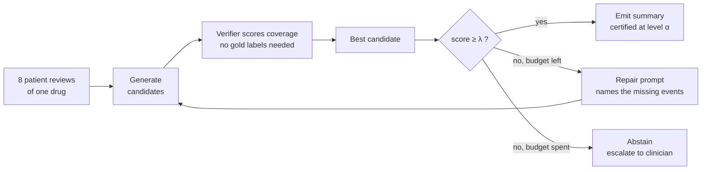
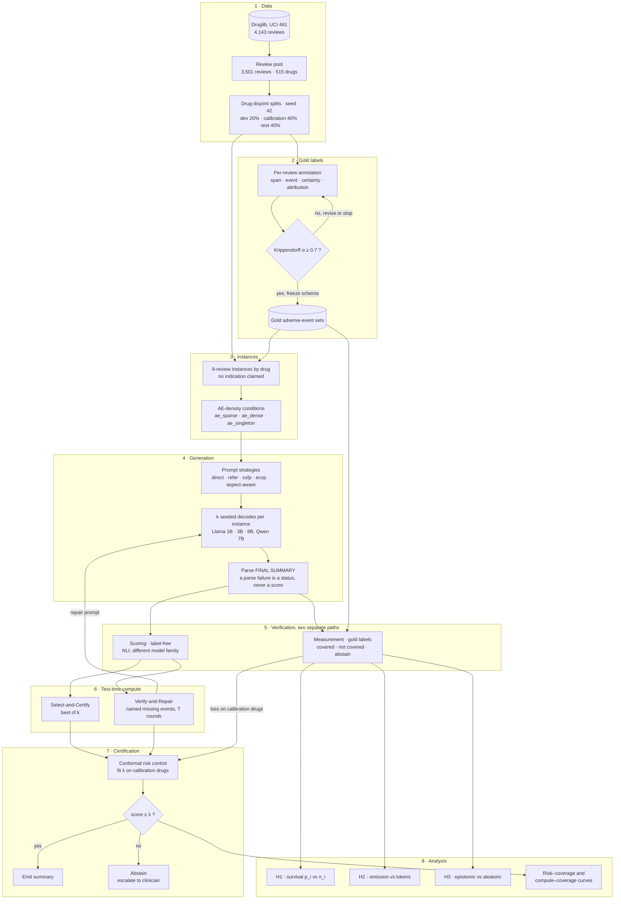

# FairSum

**Certified Coverage: Risk-Controlled Fair Summarization of Patient Drug Reviews**

> Fair coverage is not a property of a summary. It is a property of the
> **distribution over summaries**. Whether one patient's adverse-event report
> survives may be close to a coin flip across decodes of the same input. If so,
> every single-summary fairness score is one draw from a lottery it never
> describes. FairSum measures that lottery, uses test-time compute to move it,
> certifies the result with conformal risk control, and abstains when it cannot.

**Status:** Week 1 of 8. The pipeline is built and tested (280 tests). The v1
audit and feasibility numbers are in. **The headline hypothesis (H1) and the
guarantee have not been tested yet**, because both need gold annotations, which
are in progress. See [Current results](#8-current-results).

Design notes live in the Obsidian vault at
`Research Vault/Research Vault/Prathyuman-LLM Summarisation`.

---

## Contents

1. [Research problem](#1-research-problem)
2. [Research questions](#2-research-questions)
3. [Objectives](#3-objectives)
4. [Proposed solution](#4-proposed-solution)
5. [Contributions](#5-contributions)
6. [Methodology](#6-methodology)
7. [How it is novel](#7-how-it-is-novel)
8. [Current results](#8-current-results)
9. [Roadmap and decision gates](#9-roadmap-and-decision-gates)
10. [Limitations](#10-limitations)
11. [Using the code](#11-using-the-code)
12. [References](#12-references)

---

## 1. Research problem

Suppose eight patients review a drug and one of them reports a severe reaction.
A summary that silently drops that report is a safety failure, not an abstract
fairness problem. LLM summaries of patient reviews are a plausible clinical
tool, but nothing today bounds how much of the reported adverse-event signal
they lose. There are three gaps.

**1. Fairness is scored one summary at a time.** FairSumm (Zhang et al., 2024)
and Equal Coverage (Li et al., 2025) each evaluate a single decode. Sample again
and the safety content can change, yet no existing measure describes that
variation. Greedy decoding does not remove the randomness. It hides it behind
one arbitrary draw.

**2. No guarantee or abstention for abstractive summaries.** Kuwahara et al.
(2025) give conformal inclusion guarantees, but only for _extractive_ sentence
selection, and their method always produces output. Abstractive text has no
source sentences to threshold, so coverage has to be checked semantically, and
nothing lets the summarizer decline when it cannot meet the bound.

**3. The measurement is fragile.** Our v1 reimplementation used six prompting
strategies with a 1B model counting perspectives as a judge. It shows how
easily this goes wrong: parse failures scored as unfairness, three metrics that
are really one, a saturated primary endpoint, and reasoning prompts that often
never produce a summary ([§8.1](#81-audit-of-the-v1-pipeline)).

> **Problem statement.** Given a set of patient reviews for a drug, produce an
> abstractive summary whose expected omission of reported adverse events is
> provably bounded, and abstain when that bound cannot be met. Along the way,
> measure how much omission depends on decoding randomness rather than on the
> input.

---

## 2. Research questions

Hypotheses were registered before any experiment ran.

|         | Question                                                                                                                                        | Hypothesis                                                                                                                                                         | What would falsify it                                                                                                                                   |
| ------- | ----------------------------------------------------------------------------------------------------------------------------------------------- | ------------------------------------------------------------------------------------------------------------------------------------------------------------------ | ------------------------------------------------------------------------------------------------------------------------------------------------------- |
| **RQ1** | Is minority adverse-event coverage a lottery? For an event reported by $n_i$ of 8 reviews, what is its inclusion rate $p_i$ across $k$ decodes? | **H1 (headline):** $p_i$ rises with $n_i$, and for singletons ($n_i = 1$) $p_i \approx 0.5$. The model is flipping a coin rather than suppressing the report.      | $p_i \approx 0$ means suppression. $p_i \approx 1$ means no problem at this scale. $p_i$ flat in $n_i$ means coverage is unrelated to source frequency. |
| **RQ2** | Which way of spending test-time compute reduces omission most per generated token?                                                              | **H2:** At matched tokens, Verify-and-Repair beats Select-and-Certify, and the advantage is concentrated on low-$p_i$ events.                                      | Selection's omission-vs-tokens curve sits at or below repair's.                                                                                         |
| **RQ3** | What can compute _not_ fix?                                                                                                                     | **H3:** Compute reduces epistemic spread (the model wavering) but not aleatoric spread (patients genuinely disagreeing).                                           | No compute × disagreement interaction once $m$ (distinct events per instance) is controlled for.                                                        |
| **RQ4** | Can the bound be certified, and at what cost?                                                                                                   | Conformal risk control over a label-free verifier keeps realised omission on _unseen drugs_ at or below $\alpha$, with an abstention rate low enough to be useful. | Realised risk on held-out drugs exceeds $\alpha$, which means exchangeability is broken.                                                                |
| RQ0     | Were v1's prompt-fairness numbers measuring fairness at all?                                                                                    | Supporting audit.                                                                                                                                                  | —                                                                                                                                                       |

Every outcome of RQ1 is publishable. $p_i \approx 0$ reframes the paper as bias
mitigation. $p_i \approx 1$ means moving up the model ladder or making instances
harder. Only an ambiguous result is not publishable.

---

## 3. Objectives

1. **Audit** the v1 pipeline and report which of its numbers survive.
2. **Build gold adverse-event labels** on patient reviews, with span, certainty
   and attribution, reaching Krippendorff's $\alpha \ge 0.7$. Stop if
   $\alpha < 0.6$.
3. **Construct instances** from drug-disjoint splits, with conditions defined
   by adverse-event density.
4. **Measure per-event survival probabilities** $p_i$ across $k$ decodes on a
   model ladder from 1B to 8B (H1).
5. **Compare parallel and sequential test-time scaling** at matched generated
   tokens, counting rejected samples (H2).
6. **Calibrate a conformal threshold** and report realised risk on held-out
   drugs, with the abstention rate beside every number and against four
   ablations.
7. **Decompose uncertainty** into epistemic and aleatoric parts (H3). This is
   an analysis section, not load-bearing for the main claim.
8. **Release** the annotated dataset, the instance manifest and the decode
   store.

---

## 4. Proposed solution

### Coverage loss instead of a counting judge

v1 asked a judge _"how many of these 8 patients does this summary imply found
the drug Highly Effective?"_ A 50-word summary does not carry counts, so the
judge invents them. FairSum asks a question with a near-deterministic answer:
_"does this summary convey the dry skin that three reviews reported?"_

$$\ell(y) = \frac{1}{m}\sum_{i=1}^{m} \mathbb{1}\left[a_i \text{ not conveyed in } y\right]$$

Here $A = \{a_1, \dots, a_m\}$ is the set of gold adverse events for the
instance. The loss lies in $[0, 1]$ and is monotone in omissions, which is what
conformal risk control requires. Gold labels cover the source side, so all
measurement error lies on the summary side and can be measured against humans.

### Treat the decode distribution as the object of measurement

Sample $k$ summaries and let $c_{ij} = 1$ if summary $j$ covers event $a_i$.
Then:

$$p_i = \frac{1}{k}\sum_{j=1}^{k} c_{ij} \qquad U_{\text{epi}} = \frac{1}{m}\sum_{i=1}^{m} p_i(1-p_i)$$

$U_{\text{epi}}$ is largest when the model includes an event on a coin flip. If
the verifier supplies $c_{ij}$, it needs no gold labels at inference time.

### Use test-time compute as the actuator

- **Select-and-Certify (parallel).** Sample $k$ candidates, score each with the
  verifier, keep the best. Compute buys _width_.
- **Verify-and-Repair (sequential).** The verifier _names_ the missing events,
  for example "your summary omits the dry skin and the mood changes; revise",
  for up to $T$ rounds. Compute buys _depth_.

Every rejected candidate and every discarded draft counts toward the token
budget.

### Certify, or abstain

Following Angelopoulos et al. (2024), fit the acceptance threshold on
calibration drugs:

$$\hat\lambda = \inf\left\{\lambda : \frac{n\,\hat R(\lambda) + 1}{n + 1} \le \alpha\right\}$$

If the best candidate's verifier score clears $\hat\lambda$, emit it. Otherwise
the output is:

> _Insufficient confidence that reported adverse events are preserved. Escalate
> to clinician review._

**What is guaranteed.** Abstentions count as zero loss, so on a new drug from
the same population $\mathbb{E}[\ell(Y)\cdot\mathbb{1}\{\text{emit}\}] \le \alpha$.
The bound is marginal, not per summary. Risk _conditional on emitting_ is
bounded by $\alpha$ divided by the acceptance rate. Nothing holds under
distribution shift. Abstaining on everything satisfies any $\alpha$, so the
abstention rate is always reported beside the risk.



---

## 5. Contributions

| #      | Contribution                                                                                                                                                                                                                                          | Type                 | Status                                                                                                                     |
| ------ | ----------------------------------------------------------------------------------------------------------------------------------------------------------------------------------------------------------------------------------------------------- | -------------------- | -------------------------------------------------------------------------------------------------------------------------- |
| **C1** | **Coverage is a lottery.** The first measurement of per-event survival probability across repeated decodes. It recasts single-summary fairness measures as estimates from one draw.                                                                   | Empirical (headline) | Pending: Week 2 H1 probe                                                                                                   |
| **C2** | **Parallel vs. sequential scaling on a coverage objective.** The reasoning literature compares these on correctness, where the verifier returns a scalar. Here the verifier returns a _set_ of missing items.                                         | Empirical            | Pending: Week 5                                                                                                            |
| **C3** | **Selective abstractive summarization.** Conformal risk control over an NLI verifier, with abstention that carries clinical meaning. Uncertainty decomposition makes abstention _diagnostic_: "your patients genuinely disagree" rather than a shrug. | Method               | Implemented ([conformal.py](src/fairsum/conformal.py), [verifier.py](src/fairsum/verifier.py)); not yet run on gold labels |
| **C4** | **A measurement audit.** The SPD ≡ 2·UER ≡ 2·SOF identity for binary attributes. Detecting degenerate judge rows from published aggregates alone. BUR saturation at five levels. Reasoning-prompt non-compliance at 1B.                               | Methodological       | Partly verified ([§8.1](#81-audit-of-the-v1-pipeline))                                                                     |
| **C5** | **Resources.** Gold adverse-event annotations on Druglib reviews, a drug-disjoint instance manifest, a tested codebase, and a proposed distributional evaluation harness ([harness-proposal.md](harness-proposal.md)).                                | Dataset / software   | Pool and splits built; annotation in progress; harness proposed                                                            |

**Not claimed as novel.** A conformal guarantee for summarization (Kuwahara et
al., 2025) and coverage-based fairness metrics (Li et al., 2025). Both are
cited and used as machinery.

---

## 6. Methodology

| Stage                     | What happens                                                                                                                                                                                                                                                                                                                                         | Where                                                                                              |
| ------------------------- | ---------------------------------------------------------------------------------------------------------------------------------------------------------------------------------------------------------------------------------------------------------------------------------------------------------------------------------------------------- | -------------------------------------------------------------------------------------------------- |
| **0 · Audit**             | Test v1's outputs for degenerate rows using the identity SPD = 2·UER, which holds for any two genuine distributions.                                                                                                                                                                                                                                 | [audit.py](src/fairsum/audit.py), [run_audit.py](scripts/run_audit.py)                             |
| **1 · Data**              | Druglib (UCI 461), 4,143 raw reviews. Keep reviews of 20–200 words with a valid effectiveness label: 3,501 reviews across 515 drugs. Split by drug into dev/calibration/test (20/40/40) under seed 42. Written once to [split_manifest.json](data/split_manifest.json). No drug crosses a split.                                                     | [data.py](src/fairsum/data.py), [instances.py](src/fairsum/instances.py)                           |
| **2 · Gold labels**       | Annotate per review, not per instance. Fields are `span`, `event`, `certainty` (asserted / hedged / negated) and `attribution` (drug / condition / unclear). Certainty and attribution catch "no side effects at all" and "the pain was from the fibromyalgia". Two independent annotators, Krippendorff's α, adjudication.                          | [annotation.py](src/fairsum/annotation.py), [annotation_sheet.py](src/fairsum/annotation_sheet.py) |
| **3 · Instances**         | 8-review instances grouped by drug, with no indication claimed in the prompt. Conditions depend on adverse-event density: `ae_sparse`, `ae_dense` (≥ 5 distinct events) and `ae_singleton` (≥ 3 events reported by exactly one review). `ae_singleton` is oversampled because H1 lives there.                                                        | [instances.py](src/fairsum/instances.py)                                                           |
| **4 · Generation**        | $k$ seeded decodes per instance, batched, with prompt and completion tokens recorded for every sample. Six prompt strategies; the `FINAL SUMMARY:` marker is required per prompt. Model ladder: Llama-3.2-1B and 3B (fp16), Llama-3.1-8B and Qwen2.5-7B (NF4).                                                                                       | [generation.py](src/fairsum/generation.py), [prompts.py](src/fairsum/prompts.py)                   |
| **5 · Verification**      | NLI entailment with a different model family from the generator (default `microsoft/deberta-large-mnli`). Two code paths that never mix: **scoring** is label-free and drives selection; **measurement** uses gold labels and computes the loss. Uncertain cases return `ABSTAIN`, never 0. Validated against humans on κ and false-negative rate.   | [verifier.py](src/fairsum/verifier.py)                                                             |
| **6 · Test-time scaling** | Select-and-Certify (best-of-$k$) vs. Verify-and-Repair ($T$ rounds), compared on omission against total generated tokens.                                                                                                                                                                                                                            | [prompts.py](src/fairsum/prompts.py) (`build_repair_prompt`)                                       |
| **7 · Certification**     | Fit $\hat\lambda$ on calibration drugs, measure on dev, run the test split exactly once. Ablations: never-abstain, $k=1$ greedy, oracle best-of-$k$, random best-of-$k$.                                                                                                                                                                             | [conformal.py](src/fairsum/conformal.py)                                                           |
| **8 · Analysis**          | **H1:** mixed logistic model of $c_{ij}$ on $n_i$, with drug and instance random effects. **H2:** token-matched curves, tested as an interaction with $p_i$. **H3:** $U_{\text{epi}}$ on compute × source disagreement, controlling for $m$. Quality and faithfulness metrics beside every coverage number, since coverage alone is trivially gamed. | —                                                                                                  |

### Methodology diagram



---

## 7. How it is novel

Every prior measure, including v1's, scores **one summary at a time**. None
asks what happens across _repeated decodes of the same input_. That is the gap
FairSum occupies.

| Prior work                                       | What it does                                                                                            | What it does not do (FairSum's delta)                                                                                                                                  |
| ------------------------------------------------ | ------------------------------------------------------------------------------------------------------- | ---------------------------------------------------------------------------------------------------------------------------------------------------------------------- |
| **Zhang et al. 2024**, FairSumm                  | Proportional-representation fairness metrics (BUR, UER, AUC, SOF) for summaries of diverse perspectives | Scores one summary. The count-distribution metrics saturate at five levels (F3).                                                                                       |
| **Li et al. 2025**, Equal Coverage               | Redundancy-aware coverage fairness via NLI entailment; 13 LLMs; 8 reviews per input                     | Still one summary at a time. No test-time compute, no abstention. Narrow dynamic range: LLMs score 0.068–0.088 against a random baseline of 0.062.                     |
| **Kuwahara et al. 2025**, conformal importance   | First conformal inclusion guarantee for summarization, motivated by healthcare                          | **Extractive** only. Single pass. On failure it emits a longer extract rather than abstaining.                                                                         |
| **Quach et al. 2024**, conformal LM              | Sample, then apply calibrated rejection and stopping, and return a prediction set                       | Scalar admissibility signal. FairSum's verifier returns a **named set** of missing items, which is what makes repair possible. Output is one summary or an abstention. |
| **Mohri & Hashimoto 2024**, conformal factuality | Removes claims until a factuality guarantee holds                                                       | Targets _commission_, i.e. false claims. FairSum targets _omission_ and adds content back rather than removing it.                                                     |
| **Farquhar et al. 2024**, semantic entropy       | Clusters samples by meaning to detect hallucination                                                     | FairSum groups samples by _implied coverage_, asking whose voice is kept, not whether it is true.                                                                      |
| **Snell et al. 2024**, test-time compute         | Parallel vs. sequential scaling on correctness objectives                                               | A coverage objective, where verifier feedback is set-valued rather than scalar.                                                                                        |

**The novelty, strongest first:**

1. **The distribution over decodes is the unit of fairness (H1).** None of the
   works above can make this claim, because each evaluates a single summary.
2. **Reasoning prompts fail to deliver a summary at small scale (F5).** This is
   measured and cheap to reproduce, and we have not found it reported
   elsewhere.
3. **Abstractive coverage with semantic verification.** Kuwahara et al. note
   that their thresholding needs extractive sentences.
4. **Abstention with clinical meaning.** None of these methods can decline to
   answer.
5. **Test-time compute as the actuator**, with set-valued verifier feedback that
   allows repair.

**The honest risk.** If H1 returns $p_i \approx 1$ at every scale, C1
disappears and the paper becomes an application of existing machinery. That is
why the H1 probe is scheduled before the bulk annotation work.

---

## 8. Current results

> **There is no result yet on H1–H3 or on the guarantee.** What exists is an
> audit of v1, measured feasibility on the target hardware, and the data and
> split infrastructure. Each item below is tagged with how it is known.

Tags: **Measured** (run on this machine) · **Verified** (checked against v1
output) · **Proved** (analytically) · **Inferred** (from aggregates, not yet
confirmed) · **Simulated** (assumed parameters) · **Pending**.

### 8.1 Audit of the v1 pipeline

| Finding                                   | Result                                                                                                                                                                                                                                                                                                             | Status                                                                                                         |
| ----------------------------------------- | ------------------------------------------------------------------------------------------------------------------------------------------------------------------------------------------------------------------------------------------------------------------------------------------------------------------ | -------------------------------------------------------------------------------------------------------------- |
| **F1 · Degenerate judge rows**            | An estimated **~26%** of the 540 Method-A rows are JSON parse failures. Each was scored as maximal unfairness (SPD = UER = 0.2, BUR = 1, AUC = 1.0). The rate differs 7× across methods: `direct` 47.8%, `ssfp` 6.7%. On valid rows `direct` (SPD ≈ 0.154) beats `ssfp` (≈ 0.200), reversing the reported ranking. | **Inferred** from published means via SPD = 2·UER. `run_audit.py --csv` has not yet been run on the real rows. |
| **F2 · Metric redundancy**                | With a binary attribute, SPD ≡ 2·UER and SOF ≡ UER identically. Five "independent" metrics carry two degrees of freedom.                                                                                                                                                                                           | **Proved**, and **verified** on every row of the pilot table                                                   |
| **F3 · BUR saturation**                   | BUR ∈ [0.9667, 1.0] across all six methods. The whole range is 3 summaries out of 90.                                                                                                                                                                                                                              | **Verified**                                                                                                   |
| **F4 · Design confounds**                 | (1) Drugs sampled alphabetically: 53 chosen by name. (2) Instances share reviews across conditions. (3) Conditions set by rating polarity but fairness measured on effectiveness. (4) A fixed token budget handicapped reasoning prompts. (5) Every prompt asserted the first review's indication.                 | **Verified** by code reading; all five fixed in `src/fairsum`                                                  |
| **F5 · Reasoning prompts do not deliver** | Llama-3.2-1B with 320 tokens: `direct` delivers a summary **100%** of the time, `ssfp` only **58%**. The failures are not truncation: one sample stopped at 66 of 320 tokens without ever writing a summary.                                                                                                       | **Measured**                                                                                                   |

F1 is a bug in _our_ reimplementation. FairSumm estimates its distributions by
token scoring, not with a JSON counting judge, so F1 is reported honestly but is
not a critique of the field. Separately, making the marker requirement a
per-prompt contract took `direct` from 44% to 100% delivery. The old prompt
ended on the marker, so the model continued without echoing it and good output
was being thrown away.

### 8.2 Data and splits

|                                 | dev | calibration |  test |     total |
| ------------------------------- | --: | ----------: | ----: | --------: |
| drugs                           | 103 |         206 |   206 |   **515** |
| reviews                         | 701 |       1,323 | 1,477 | **3,501** |
| drugs with ≥ 8 reviews (usable) |  28 |          51 |    65 |   **144** |
| instances at 5 draws per drug   | 140 |         255 |   325 |       720 |

**Measured.** Grouping by (drug, indication) instead of by drug leaves only
**42** usable groups against **144**, a 70% loss. Druglib's free-text condition
field averages 4.5 distinct indications per drug. The default is therefore to
group by drug and have the prompt claim no indication: a prompt that asserts
nothing cannot assert something false.

> The usable-drug row, not the instance row, is the honest sample size.
> Instances within a drug share reviews.

### 8.3 Generation throughput

**Measured** on an RTX 4070 Laptop (8 GB) with Llama-3.2-1B in fp16, 8-review
prompts and `max_new_tokens=320`:

| method   | batch | gen/s | peak VRAM | 8,000 generations | summary delivered |
| -------- | ----: | ----: | --------: | ----------------: | ----------------: |
| `direct` |     8 |  0.76 |    5.3 GB |             2.9 h |          **100%** |
| `ssfp`   |     4 |  0.30 |    4.3 GB |             7.5 h |               58% |
| `ssfp`   |     8 |  0.34 |    6.0 GB |             6.5 h |           **58%** |

**Cap the batch at 8.** Batch 16 peaked at 9.37 GB, above physical VRAM.
Windows spilled into host memory instead of failing with an out-of-memory
error, and throughput fell to 0.24 gen/s, _worse_ than batch 8. Best-of-16 over
about 500 instances takes an afternoon at 1B and an overnight run at 8B.

### 8.4 Calibration sample size

**Proved.** The finite-sample slack of conformal risk control is $1/(n+1)$.
Here is how much of an $\alpha = 0.1$ budget that slack consumes:

| calibration $n$           |      45 |    90 |    150 |    200 |    300 |    500 |
| ------------------------- | ------: | ----: | -----: | -----: | -----: | -----: |
| floor                     |   0.022 | 0.011 | 0.0066 | 0.0050 | 0.0033 | 0.0020 |
| share of α spent on slack | **22%** |   11% |   6.6% |   5.0% |   3.3% |   2.0% |

v1's implied calibration split (45 instances) would have spent a fifth of the
risk budget on slack alone.

**Simulated.** Setup: 53 drugs × 8 instances, 300 trials, with an _assumed_
drug-level correlation. Calibration sets were resampled two ways, by instance
and by drug. Mean realised risk was 0.096 resampling by drug vs. 0.095 by
instance, with standard deviations 0.0132 and 0.0109. The ratio is 1.21×, below
the 1.5× threshold that would make drug count the effective $n$. So instance
count is defensible _at this assumed correlation_, and drug counts are reported
alongside anyway. About a third of single trials exceed α. That is expected:
the guarantee bounds the _expected_ risk, not every calibration draw. This must
be re-run on real verifier scores once generations exist.
([results/day05_power.csv](results/day05_power.csv); re-running with the
current script defaults gives a ratio of 1.30×, which leads to the same
verdict.)

### 8.5 Annotation

**Pending.** The pilot batch is 50 reviews across 15 drugs, restricted to drugs
that can form an instance. Sheets have been exported for two annotators: one
covers all 50 reviews, the other a blind 30-review agreement subset. **Neither
sheet is complete yet**, so Krippendorff's α and the schema gate are still open.

### 8.6 Software

**Measured.** 280 tests pass in about 2 seconds. Every code path has run at
least once, including GPU generation and the NLI verifier, via
[smoke_e2e.py](scripts/smoke_e2e.py). That script uses placeholder
keyword-matched events, not gold annotations, so its numbers are meaningless
by design: it only proves the plumbing connects.

---

## 9. Roadmap and decision gates

Every week ends in a gate. A week that cannot pass its gate does not roll
forward silently.

**Week 1 (current)**

| Day | Task                                 | Gate                                 | State                                                 |
| --- | ------------------------------------ | ------------------------------------ | ----------------------------------------------------- |
| 1   | Degenerate-row audit of v1           | Is v1 salvageable or scrap?          | Script ready; needs the v1 results CSV                |
| 2   | Batched harness and throughput       | What $k$ is affordable?              | Done ([§8.3](#83-generation-throughput))              |
| 3   | Review pool, splits, 50-review pilot | Time annotation honestly             | Pool and batch built; annotation in progress          |
| 4   | Two-annotator agreement              | α ≥ 0.7 freeze · < 0.6 stop          | Waiting on Day 3                                      |
| 5   | Power analysis                       | Is effective $n$ instances or drugs? | Done, simulated ([§8.4](#84-calibration-sample-size)) |

**Weeks 2–8**

| Week | Work                                                           | Gate                                                           |
| ---- | -------------------------------------------------------------- | -------------------------------------------------------------- |
| 2    | **H1 probe:** ~20 `ae_singleton` instances, $k = 32$, 1B model | Is $p_i \approx 0.5$ for singletons? Go/no-go for the framing. |
| 3    | Finish annotation; build and validate the verifier             | Verifier–human κ ≥ 0.7 with a low false-negative rate          |
| 4    | Select-and-Certify, conformal layer, four ablations            | Does dev risk track nominal α?                                 |
| 5    | Verify-and-Repair; token-matched comparison (H2)               | Does repair's advantage concentrate on low-$p_i$ events?       |
| 6    | Model ladder; quality and faithfulness guard; H3               | Does coverage rise without collapsing into bare event lists?   |
| 7    | Test split, run exactly once                                   | No returning to tune                                           |
| 8    | Writing; dataset release                                       | —                                                              |

---

## 10. Limitations

Stated up front rather than discovered by reviewers.

- **Verifier error pulls $p_i$ toward 0.5.** That is the direction that
  flatters H1. H1 is claimed on a sensitivity/specificity-corrected estimate or
  not at all ([harness-proposal.md §5](harness-proposal.md)).
- **The guarantee is marginal** and assumes exchangeability at the drug level.
  It says nothing about an individual summary, and nothing under a shift to a
  new drug class or review source.
- **The loss is unweighted.** Dropping a liver-damage report costs the same as
  dropping dry lips. Severity weighting needs an annotation axis with much lower
  expected agreement and is deferred.
- **Length vs. $m$.** With many distinct events, full coverage may be impossible
  in about 50 words, and then the loss partly measures length. It is reported
  against a length control.
- **Druglib predates 2010 and is widely mirrored.** Safety profiles have
  changed, and the models have probably seen the corpus. A membership check is
  planned.
- **Small annotator pool.** Agreement is reported honestly and the data will be
  released for re-annotation.

---

## 11. Using the code

### Install

```bash
pip install -e ".[dev]"          # pure-logic modules + tests
pip install -e ".[dev,annotate]" # adds openpyxl for the annotation sheet
pip install -e ".[dev,gen]"      # adds torch / transformers for generation
pytest                           # 280 tests, ~2 s
```

Verified on Python 3.12.3, torch 2.6.0+cu124, transformers 5.2.0, RTX 4070
Laptop (8 GB).

### Week 1 pipeline

```bash
# Day 1: audit v1. With no arguments, prints the rate predicted from aggregates.
python scripts/run_audit.py --csv <v1_results>.csv

# Day 2: throughput
python scripts/bench_throughput.py --model meta-llama/Llama-3.2-1B-Instruct

# Days 3 and 5: pool, drug-disjoint splits, pilot batch
python scripts/build_pool.py --seed 42 --annotation-batch 50 --annotation-drugs 15

# Days 3–4: annotation sheets (the second annotator's sheet carries no labels)
python scripts/annotation_sheet.py export --batch data/annotation_batch_pilot.csv --out annotations/nishan.xlsx
python scripts/annotation_sheet.py export --batch data/annotation_batch_pilot.csv --out annotations/prathyuman.xlsx --subset 30
python scripts/annotation_sheet.py import --sheet annotations/nishan.xlsx --out annotations/nishan.jsonl

# Day 4: the schema gate
python scripts/check_agreement.py --a annotations/nishan.jsonl --b annotations/prathyuman.jsonl

# Day 5: calibration power
python scripts/power_analysis.py --alpha 0.1
```

`import` refuses any sheet with a review not marked done, a partly filled event
slot, or a blank certainty or attribution, and lists every problem at once.

### Modules

| Module             | Purpose                                                                                        |
| ------------------ | ---------------------------------------------------------------------------------------------- |
| `metrics`          | FairSumm metrics (Zhang et al., Defs 5.1–5.4). Degenerate counts are **reported, not scored**. |
| `audit`            | The Day 1 diagnostic and the back-out estimator                                                |
| `data`             | Druglib loading (direct zip; no `ucimlrepo` dependency)                                        |
| `instances`        | Instance construction, drug-disjoint splits, AE-density conditions, annotation batch selection |
| `annotation`       | AE schema, JSONL storage, Krippendorff's α, the agreement gate                                 |
| `annotation_sheet` | Export a batch to `.xlsx` for annotation; validate a filled sheet and read it back             |
| `prompts`          | Six prompt strategies, the repair prompt, `FINAL SUMMARY:` parsing                             |
| `generation`       | Batched $k$-sample decoding with full token accounting                                         |
| `verifier`         | NLI coverage checking, with scoring and measurement kept separate                              |
| `conformal`        | Conformal risk control threshold fitting, risk–coverage curves                                 |

### Three invariants the code enforces

**A failure is never a score.** v1's judge returned all-zero counts on a JSON
parse error, which became SPD = UER = 0.2, BUR = 1, AUC = 1.0. That is
indistinguishable from a genuinely unfair summary. Here `normalize_counts`
raises, `Metrics` carries a `status`, the verifier has an `ABSTAIN` verdict, and
`parse_final_summary` returns `NO_MARKER` rather than falling back to raw text.

**The judge is never the generator.** `verifier.py` takes an injected
entailment model. Scoring (label-free, drives selection) and measurement (gold
labels, computes the loss) are separate entry points.

**Rejected work still counts.** Every generation is recorded with its token
counts, including samples that lose selection, because H2 compares parallel and
sequential scaling per token.

---

## 12. References

- Angelopoulos, A. N., et al. (2024). _Conformal Risk Control._ ICLR. †
- Farquhar, S., et al. (2024). _Detecting hallucinations in large language
  models using semantic entropy._ Nature. †
- Kuwahara, et al. (2025). _Document Summarization with Conformal Importance
  Guarantees._ NeurIPS. arXiv:2509.20461.
- Li, H., Zhang, Y., Zhang, R., & Chaturvedi, S. (2025). _Coverage-based
  Fairness in Multi-document Summarization._ NAACL, pp. 9801–9819.
- Mohri, C., & Hashimoto, T. (2024). _Language Models with Conformal Factuality
  Guarantees._ ICML. †
- Quach, V., et al. (2024). _Conformal Language Modeling._ ICLR. †
- Snell, C., et al. (2024). _Scaling LLM Test-Time Compute Optimally Can Be More
  Effective than Scaling Model Parameters._ †
- Zhang, Y., et al. (2024). _Fair Abstractive Summarization of Diverse
  Perspectives._ NAACL. †
- Druglib.com Drug Review Dataset. UCI Machine Learning Repository, id 461.

† Venue and author details not yet checked against the paper. Verify before
citing in a draft. Kuwahara et al. and Li et al. were verified from the PDFs in
`Papers/`.
