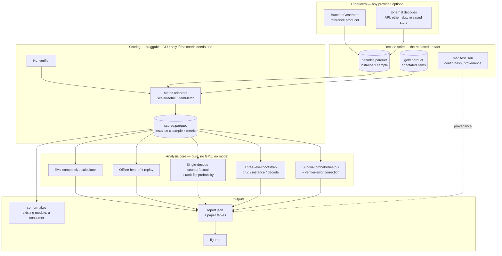
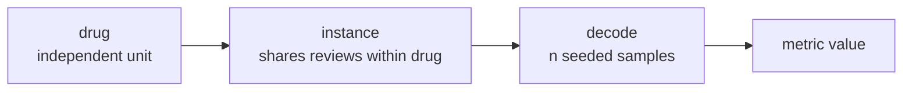

# A distributional evaluation harness for summarization

**Status:** proposal, not started · **Date:** 2026-09-11 · **Decision owner:** Nishan

> [!question] The one-sentence claim
> Every published summarization metric scores one decode; the quantity it is
> estimating is a random variable whose spread nobody reports. This harness makes
> the spread the unit of measurement, and makes a single-decode number
> inexpressible.

---

## 1. Why this exists

The v3 claim in [`FairSum Paper Plan`](../../Research%20Vault/Research%20Vault/Prathyuman-LLM%20Summarisation/Plan/FairSum%20Paper%20Plan.md)
is that _fair coverage is a property of a distribution over summaries, not of a
summary_. If that is true, it is not only a finding about drug reviews — it is a
statement about how the subfield measures anything at all. A finding of that
shape wants a matching instrument, and the instrument is more citable than the
finding.

So the artifact is not another metric. It is a layer that takes metrics it does
not own — FairSumm's Definitions 5.1–5.4, Li et al.'s Equal Coverage, ROUGE,
AlignScore, whatever a user brings — and reports each one as a distribution over
decodes rather than a point. Prior work's numbers can then be recomputed under
it, which is the paper's argument made executable rather than asserted.

**The differentiator is structural, not one of breadth.** lm-evaluation-harness
and HELM are single-decode by construction: one completion per instance, one
score, one leaderboard row. Neither is wrong; both answer a different question.
This harness cannot express a single-decode number, in the same way that
`normalize_counts` cannot express a score for a failed parse.

### Decisions already taken

| Question                    | Decision                                                                                              |
| --------------------------- | ----------------------------------------------------------------------------------------------------- |
| Role in the research output | **Co-contribution** — released with the H1 paper, not internal tooling                                |
| Scope                       | **A distributional layer over any metric** — owns sampling, estimation and reporting; owns no metrics |
| Model surface               | **Provider-agnostic** — input is a decode store, not a model; the HF adapter is a reference producer  |
| Analysis depth              | **Descriptive + decision layer** (approach B); annotator-level variance deferred (§11)                |

---

## 2. Architecture



**The load-bearing property is the vertical cut between the store and the
analysis core.** Everything above the store needs a GPU and a model; everything
below needs neither. That is what makes the released store a GPU-free
reproduction of every experiment in the paper, and what lets a third party run a
metric you have never heard of against your decodes without regenerating them.

It is also the existing invariant, promoted to an architecture: _generate once,
analyse many times_ is already written in
[`Generation Harness`](../../Research%20Vault/Research%20Vault/Prathyuman-LLM%20Summarisation/Experiments/Generation%20Harness.md).

---

## 3. The decode store

Three tables plus a manifest. Parquet for size, with a JSONL export for
inspection and diffing.

**`decodes.parquet`** — one row per generated sample.

| field                                                     | why it is there                                                |
| --------------------------------------------------------- | -------------------------------------------------------------- |
| `store_version`                                           | the schema is versioned from day one (§12, risk 4)             |
| `instance_id`, `drug_id`, `split`                         | `drug_id` is the top bootstrap level, not decoration           |
| `sample_index`, `seed`                                    | reproducibility, and the unit of the decode lottery            |
| `model_id`, `precision`, `prompt_strategy`, `prompt_hash` | provenance for the ladder                                      |
| `temperature`, `top_p`, `max_new_tokens`                  | the decode distribution is defined by these                    |
| `raw_text`, `parsed_summary`, `parse_status`              | raw is kept; parse failure is a status, never an empty summary |
| `prompt_tokens`, `completion_tokens`                      | H2's denominator, including samples that lose selection        |

This is `GenerationRecord` with `drug_id`, `split` and `store_version` added.
The existing dataclass is close enough that the change is additive.

**`gold.parquet`** — annotated items per instance: `instance_id`, `item_id`,
`canonical_label`, `n_reporting_reviews`, `certainty`, `attribution`. Sourced
from `annotation.py`; `item_id` is what survival probabilities are indexed by.

**`scores.parquet`** — one row per (instance, sample, metric, item). Separating
this from `decodes.parquet` is what makes re-scoring free: a new metric appends a
partition and never rewrites a decode.

**`manifest.json`** — config hash, git SHA, package versions, producer identity,
timestamps, and the verifier's measured error rates (§5). A store without a
manifest is not loadable; provenance is a precondition, not metadata.

---

## 4. Metric interface

Two tiers, because the second one is what unlocks the headline and the first one
is what makes adoption plausible.

```python
@dataclass(frozen=True)
class MetricValue:
    value: float | None
    status: MetricStatus          # reused from fairsum.metrics

class ScalarMetric(Protocol):
    name: str
    def __call__(self, summary: str, instance: Instance) -> MetricValue: ...

class ItemMetric(Protocol):
    """Per-item coverage. Unlocks survival probabilities."""
    name: str
    def __call__(
        self, summary: str, instance: Instance
    ) -> Mapping[str, MetricValue]: ...   # item_id -> covered / not / abstain
```

A `ScalarMetric` gets the full distributional treatment: mean, sd, quantiles,
$P(M < \tau)$, and the counterfactual of §6. An `ItemMetric` gets all of that
_plus_ per-item survival probabilities, which is where H1 lives.

**The three repo invariants are enforced at this boundary, not inside metrics.**
`MetricValue` carries `MetricStatus`, so a failed metric is structurally
incapable of contributing a zero to a mean — the harness drops it and reports the
abstention rate beside every number, exactly as the paper plan requires. A metric
that raises is recorded as `status=ERROR` for that sample and the run continues;
a run whose error rate exceeds a configured ceiling fails loudly rather than
silently reporting a mean over survivors.

Registration is by entry point, so a third party adds a metric without forking.

---

## 5. Survival probabilities, and the verifier problem

For instance $x$ with gold items $a_1 \dots a_m$ and $n$ decodes, let
$c_{ij} = 1[a_i \text{ covered in decode } j]$. Then

$$\hat p_i = \frac{1}{n}\sum_{j=1}^{n} c_{ij}$$

reported with a Wilson score interval, never a normal approximation — at
$n = 16$ and $\hat p$ near 0 or 1 the normal interval leaves the unit interval,
and the whole claim is about values near $\tfrac12$.

**The thing a reviewer will attack first:** $\hat p_i$ mixes decode randomness
with verifier error. A verifier with 85% sensitivity drags every $\hat p_i$
toward $\tfrac12$, which is the direction that flatters H1. This has to be
answered in the instrument, not the limitations section.

So the harness requires verifier sensitivity and specificity, estimated on the
annotation agreement subset, to be recorded in the manifest, and reports both the
raw $\hat p_i$ and a prevalence-corrected

$$\hat p_i^{\text{corr}} = \frac{\hat p_i + \text{spec} - 1}{\text{sens} + \text{spec} - 1}$$

with intervals propagated through the correction. H1 is claimed on the corrected
quantity or it is not claimed. If the correction is unstable because
$\text{sens} + \text{spec}$ is near 1, that is itself the finding: the verifier
is not good enough to measure the lottery, and the harness says so rather than
producing a number.

---

## 6. The single-decode counterfactual

The instrument's rhetorical core. Given the same decode store, the harness
reports what a conventional evaluation _would have concluded_ had it drawn one
decode, as conventional evaluations do:

- **Point-estimate spread.** The empirical distribution of $M(y^{(j)})$ across
  $j$, beside the mean that a single-decode paper would have reported as if it
  were the mean.
- **Rank-flip probability.** For two systems $A$ and $B$ evaluated on the same
  instances, $\Pr[\hat M_A^{(1 \text{ decode})} > \hat M_B^{(1 \text{ decode})}]$
  estimated by resampling one decode per instance per system. If that probability
  sits near $\tfrac12$ while the reported means differ, then the leaderboard
  those means produce is a coin flip, and this is the number the paper leads
  with.

Rank-flip is computed for every pair of configurations in a run — prompt
strategies, model ladder rungs, $k$ values — so the same machinery that supports
the headline also tells you which of your own comparisons are real.

---

## 7. Three-level bootstrap, and Open Problem #2

Variance is resampled at three nested levels: **drug → instance → decode**.
Instances within a drug share reviews, so drugs are the independent unit; this is
[`FairSum Open Problems`](../../Research%20Vault/Research%20Vault/Prathyuman-LLM%20Summarisation/Plan/FairSum%20Open%20Problems.md)
#2 restated as an estimation procedure rather than a worry.



Resampling drugs, then instances within drug, then decodes within instance gives
the honest interval. Holding levels fixed one at a time attributes the variance,
and the standard error of a mean over $N$ drugs, $I$ instances each, $n$ decodes
each is

$$\mathrm{SE} \;=\; \sqrt{\frac{\sigma^2_{\text{drug}}}{N} + \frac{\sigma^2_{\text{inst}}}{NI} + \frac{\sigma^2_{\text{dec}}}{NIn}}$$

**Which settles Open Problem #2 numerically rather than by argument.** The first
term does not shrink with more decodes or more reviews per drug — if
$\sigma^2_{\text{drug}}$ dominates, 53 drugs is the binding constraint and the
annotation pool must widen rather than deepen, and the harness prints how much.

---

## 8. Offline best-of-_k_ replay

With $n$ decodes banked, any selection strategy over any $k \le n$ replays with
zero GPU: subsample $k$ without replacement, apply the label-free selection rule
(`verifier.score_coverage`), measure the winner with gold labels
(`verifier.measure_coverage`), repeat $B$ times.

Consequences worth being explicit about:

- **H1 and H2 become queries against one store** rather than two generation
  campaigns. The best-of-$k$ curve and the repair curve are both read off decodes
  you already paid for.
- **H2's compute accounting becomes exact by construction.** "Every rejected
  candidate counts toward the denominator" stops being bookkeeping discipline and
  becomes a property of the replay: the tokens are in the store.
- **The bias is stated, not hidden.** Subsampling without replacement from a
  finite pool understates variance as $k \to n$. The harness refuses $k > n/2$ by
  default and records the ratio in the report.

Sequential repair does _not_ fully replay — a repair round conditions on a draft
the store may not contain. The harness replays the first round and flags the rest
as requiring generation; H2's sequential arm is a producer-side run whose outputs
land back in the store as a new `prompt_strategy`.

---

## 9. Eval sample-size calculator

The inverse of §7, and the feature most likely to change what other people do.
Given a target half-width $\varepsilon$ and the variance components measured from
a pilot store, solve for the $(N, I, n)$ surface that reaches it, and plot the
iso-cost curve against generated tokens.

It answers, with numbers, the question every evaluation paper currently answers
by convention: _how many decodes does reporting this metric honestly require?_
For most metrics the answer will be "more than one, fewer than you feared," and
that sentence is the harness's pitch.

---

## 10. What is reused, what is new

| Existing module               | Role                                                                                           |
| ----------------------------- | ---------------------------------------------------------------------------------------------- |
| `generation.BatchedGenerator` | reference producer; `GenerationRecord` gains `drug_id`, `split`, `store_version`               |
| `verifier`                    | wrapped as an `ItemMetric`; scoring and measurement stay separate entry points                 |
| `metrics`                     | wrapped as `ScalarMetric`s; `MetricStatus` is reused verbatim at the harness boundary          |
| `instances`                   | `Instance` is the metric-call context; `assign_drug_splits` supplies the bootstrap's top level |
| `annotation`                  | produces `gold.parquet`; the agreement subset also yields verifier sens/spec (§5)              |
| `conformal`                   | unchanged, and becomes a _consumer_ of `scores.parquet` rather than a sibling of it            |

New packages: `store/` (schema, read/write, manifest, validation), `registry/`
(metric and task registration), `estimate/` (survival, bootstrap, counterfactual,
replay, calculator), `report/` (tables, figures), `cli/`.

The only refactor of consequence is adapting `metrics.fairsum_metrics`, which
today takes count mappings, to a `(summary, instance) → MetricValue` adapter.
That is an adapter, not a rewrite.

### Packaging

A separate installable package in this repo, with `fairsum` depending on it —
not a `fairsum.harness` subpackage. Nobody installs a drug-review package to
evaluate CNN/DailyMail, and the co-contribution framing dies at the import
statement. The decode-store schema ships as a documented, versioned format so a
producer in any language can write one; the Python package is the reference
implementation, not the definition.

**Name — open.** The concept is the decode lottery. `recount` (you count again,
and it is an election word) is my preference; `lottery` is more evocative and
less greppable; `spread` is taken on PyPI in spirit if not in fact. Decide before
the first release tag, because the store format embeds it.

---

## 11. Non-goals

Listed because each one is a thing a reviewer or a contributor will ask for, and
the answer should be a decision rather than a shrug.

- **No training, fine-tuning, or model hosting.**
- **No hosted-API adapters in v1.** Provider-agnostic input makes them somebody
  else's afternoon; per-provider sampling semantics and unhonoured seeds are not
  a v1 problem.
- **No annotator-level variance component** (approach C). With one annotator and
  a 150-review agreement subset, the term would be estimated from thin data and
  is the part reviewers would poke hardest. The three-level design leaves a
  fourth level to slot in — it is a new resampling level and a new variance term,
  not a redesign — so this reverses cheaply if a second annotator materialises.
  Stated in limitations, not quietly omitted.
- **No leaderboard, no web UI, no dataset hosting** beyond the released store.
- **No prompt DSL.** Prompts are strings with a recorded hash.
- **No general summarization breadth chase.** Breadth is where HELM already sits;
  the claim here is structural.

---

## 12. Risks

1. **The build eats the H1 probe.** This is the real one: Open Problems #1 says
   reposition before further building, and the probe now needs ~20 annotated
   instances rather than 720. Mitigation is the milestone order in §14 —
   M0 exists to make H1 answerable and nothing else, and annotation runs in
   parallel with it because annotation is the critical path, not the harness.
2. **Verifier noise masquerading as decode variance.** §5. Measured, corrected,
   and reported both ways; if the correction is unstable the harness declines to
   report $p_i$.
3. **$n$ too small to see the lottery.** The calculator answers it, but not
   before the first run — so pre-register $n$ from the pilot store and report the
   pilot's variance components alongside.
4. **Store-format churn breaking released artifacts.** `store_version` from the
   first commit, validation on load, and a migration path per bump.
5. **Contamination** (Open Problems #7). Not solved here. The manifest records
   `model_id` and a membership-probe result field so the question is answerable
   per store rather than per paper.
6. **"Why not just use HELM?"** Answered in the README's first paragraph, in the
   terms of §1: they are single-decode by construction. If that answer does not
   convince a reviewer, the co-contribution framing is in trouble and the
   fallback is approach B's internal-infrastructure role.

---

## 13. Testing

Matching the repo's existing standard — 201 tests, fast, logic separated from
model calls.

- **Property tests.** Survival probabilities in $[0,1]$; Wilson intervals contain
  $\hat p$; replay at $k = n$ equals direct computation; the calculator inverts
  the §7 variance formula; bootstrap CIs achieve nominal coverage on synthetic
  data with known ground truth.
- **Invariant tests.** A metric returning a non-OK status never contributes to a
  mean. A store without a manifest fails to load. A run exceeding the error
  ceiling fails rather than reports.
- **Golden-file test** on a tiny committed store, so schema changes are visible
  in a diff.
- **No GPU in the test suite.** The vertical cut of §2 means the analysis core is
  testable with fixtures, which is most of the code.

---

## 14. Milestones

| #      | Deliverable                                                            | Gate                                                                                   |
| ------ | ---------------------------------------------------------------------- | -------------------------------------------------------------------------------------- |
| **M0** | Store schema + writer, survival probabilities with verifier correction | **H1 is answerable from ~20 annotated instances.** Nothing else ships until this does. |
| M1     | Three-level bootstrap, single-decode counterfactual, rank-flip         | the paper's headline table exists                                                      |
| M2     | Offline best-of-_k_ replay, sample-size calculator                     | H2's parallel arm needs no new generation                                              |
| M3     | Registry, CLI, docs, released store + format spec                      | the artifact is installable by a stranger                                              |
| M4     | _Deferred:_ annotator variance, hosted-API adapters                    | only after the H1 result is known                                                      |

M0 and annotation run concurrently. If M0 slips, annotation does not.

---

## 15. Open questions

1. **Name.** §10. Blocks the first release tag, nothing before it.
2. **Does the item granularity problem (Open Problems #3) change `item_id`?**
   Survival probabilities are indexed by canonical item, so a merge/split
   decision after the store is written invalidates $\hat p_i$. The store should
   record the surface span alongside the canonical label so re-canonicalisation
   is possible offline — worth confirming the annotation schema keeps spans.
3. **Length control (Open Problems #4) as a registered covariate?** If coverage
   is partly a length measure, the harness should carry summary length as a
   first-class column and report coverage conditional on it. Cheap to add now,
   awkward later.
4. **Is `rank_flip_probability` the headline, or is $p_i \approx 0.5$?** They are
   different papers in emphasis: one is about the field's leaderboards, the other
   about fairness specifically. The harness computes both; the paper has to
   choose which one opens.

---

## Related

[`Prathyuman-LLM Summarisation MOC`](../../Research%20Vault/Research%20Vault/Prathyuman-LLM%20Summarisation/Prathyuman-LLM%20Summarisation%20MOC.md) ·
[`H1 Coin-Flip Minority Coverage`](../../Research%20Vault/Research%20Vault/Prathyuman-LLM%20Summarisation/Hypotheses/H1%20Coin-Flip%20Minority%20Coverage.md) ·
[`H2 Repair Beats Selection`](../../Research%20Vault/Research%20Vault/Prathyuman-LLM%20Summarisation/Hypotheses/H2%20Repair%20Beats%20Selection.md) ·
[`Generation Harness`](../../Research%20Vault/Research%20Vault/Prathyuman-LLM%20Summarisation/Experiments/Generation%20Harness.md) ·
[`Parallel vs Sequential Scaling`](../../Research%20Vault/Research%20Vault/Prathyuman-LLM%20Summarisation/Concepts/Parallel%20vs%20Sequential%20Scaling.md)
